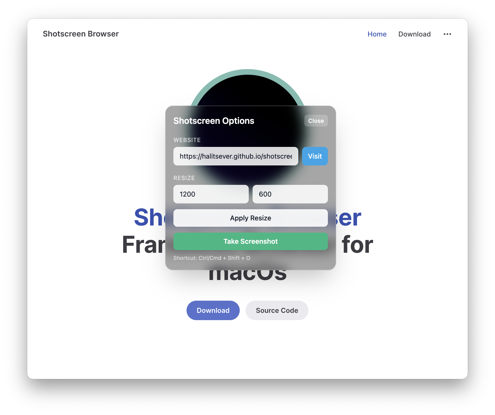

<p align="center" class="logo-section">

</br>


<p align="center">
🌐 Shotscreen Browser: a frameless desktop browser for clean website screenshots on macOS, with viewport presets, full-page capture, rounded corners and dark mode. Built with Electron and Vue.<br>
<br/>
<br/>
 
 
</p>
<p align="center">
<a align="center" href="https://halitsever.github.io/shotscreen">Download</a>
</p>

<p align="center"><a href="https://www.producthunt.com/products/shotscreen-browser-for-screenshots?embed=true&amp;utm_source=badge-featured&amp;utm_medium=badge&amp;utm_campaign=badge-shotscreen-browser-for-screenshots"></a></p>

> **macOS — First Launch**  
> Gatekeeper will block the app on first open. Run this once in Terminal after moving it to Applications:
>
> ```bash
> xattr -cr "/Applications/Shotscreen Browser.app"
> ```

  </p>
</p>

<a align="center">

</a>

- 🖼️ [**Minimal desktop app**](#) - A minimal desktop app for getting frameless screenshots
- [**Frameless window**](https://halitsever.github.io/shotscreen/) - no toolbar and no title bar, so the screenshot contains only the website.
- [**Viewport presets**](https://halitsever.github.io/shotscreen/#viewport) - switch between iPhone, iPad, MacBook, Desktop and Ultrawide sizes, or type a custom size.
- [**Full-page capture**](https://halitsever.github.io/shotscreen/#capture-mode) - capture the whole scroll height of a page in one shot.
- [**Rounded corners**](https://halitsever.github.io/shotscreen/#settings-corner-radius) - pick a preset or any radius from 0 to 32 px for the saved image.
- [**Dark mode and cookie banner hiding**](https://halitsever.github.io/shotscreen/#capture-options) - force a site into dark mode and hide cookie consent overlays before capturing.
- [**Shot history and shortcut**](https://halitsever.github.io/shotscreen/#shot-history) - see recent captures and take a screenshot with `⌘ ⇧ S`.

<p align="center">

</p>

<a align="center" >

</a>

Download the latest macOS build from [GitHub Releases](https://github.com/halitsever/shotscreen/releases). The [download page](https://halitsever.github.io/shotscreen/download.html) covers the first launch.

Install packages:

```bash
npm install
```

Run app in dev mode:

```
npm run start
```

<a align="center" href="https://github.com/halitsever/shotscreen/issues">

</a>

<p align="center">
Found a bug or have an idea? Open an <a href="https://github.com/halitsever/shotscreen/issues">issue</a>.<br/>
Read the <a href=".github/CONTRIBUTING.md">contributing guide</a> before sending a pull request.
</p>

<a align="center">

</a>

<a align="center">

</a>

<p align="center">
 MIT LICENSE 2024 | Halit Sever
</p>
